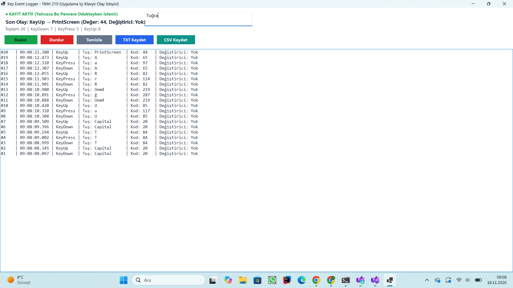
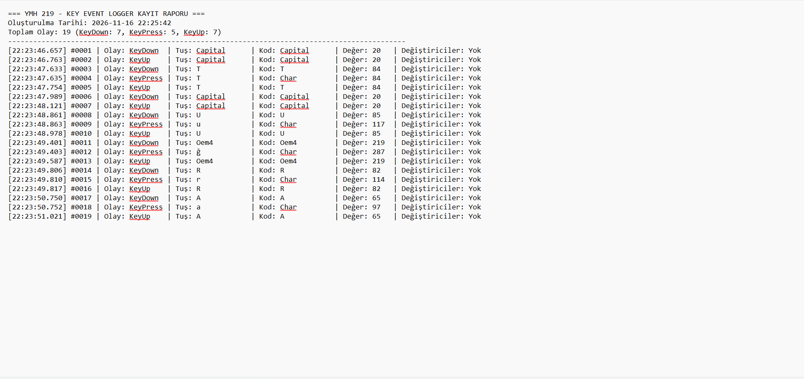
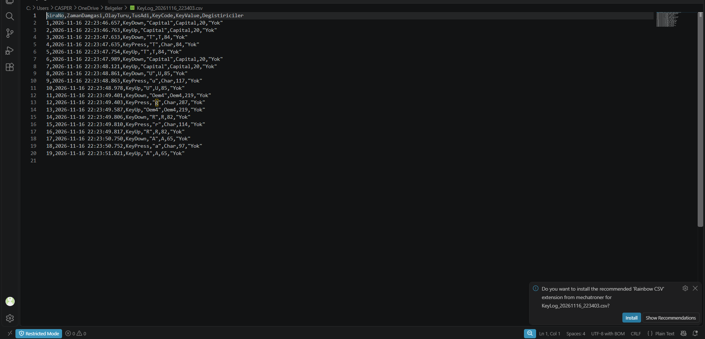

# YMH219-KeyEventLogger

Bu proje, **Fırat Üniversitesi Yazılım Mühendisliği Bölümü** **Nesne Tabanlı Programlama (YMH 219)** dersi kapsamında geliştirilmiş, yalnızca uygulama penceresi odaktayken çalışan C# Windows Forms tabanlı bir **Key Event Logger (Klavye Olay İzleyici)** uygulamasıdır.

## Etik Sınır ve Çalışma Prensibi
- Uygulama **kesinlikle arka planda veya sistem genelinde (global hook) gizli dinleme yapmaz**.
- Yalnızca uygulama penceresi aktif (odakta) iken `KeyPreview = true` özelliği üzerinden klavye olaylarını yakalar ve pencere kapatıldığında tüm bellek kayıtlarını sonlandırır.

## Kullanılan Teknolojiler
- **Dil:** C#
- **Platform / Framework:** .NET Windows Forms (WinForms)
- **Geliştirme Ortamı:** Visual Studio 2026
- **Versiyon Kontrol:** Git & GitHub

## Kurulum ve Çalıştırma Adımları
1. Depoyu bilgisayarınıza klonlayın:
   `git clone https://github.com/yusuftugradeveci23/YMH219-KeyEventLogger.git`
2. İndirilen klasör içerisindeki `YMH219-KeyEventLogger/YMH219-KeyEventLogger.slnx` (veya `.csproj`) dosyasını Visual Studio ile açın.
3. Üst menüden **Derle > Çözümü Derle (Build Solution)** işlemini gerçekleştirin.
4. **F5** tuşuna basarak veya **Başlat (Start)** butonuna tıklayarak uygulamayı çalıştırın.

## Uygulamanın Temel Özellikleri
- **Nesne Tabanlı Mimari (OOP):** Kayıt veri modeli `KeyLogEntry`, bellek yönetimi, sayaç istatistikleri ve dosya dışa aktarma işlemleri `KeyLogManager` sınıflarına ayrıştırılmıştır.
- **Üç Aşamalı Olay Yakalama:** Basılan her tuş için `KeyDown`, `KeyPress` ve `KeyUp` olayları zaman damgası (`HH:mm:ss.fff`), `KeyCode`, sayısal değer (`KeyValue`) ve değiştirici tuş (`Ctrl`, `Shift`, `Alt`) bilgileriyle yakalanır.
- **Canlı İstatistik ve ListBox Görüntüleme:** Yakalanan tuş olayları ve zaman damgaları `ListBox` bileşeni üzerinde hizalı ve kronolojik biçimde listelenir; toplam ve olay bazlı sayaçlar anlık güncellenir.
- **Kayıt Kontrolü ve Dışa Aktarma:** Kayıt akışı ayrı **Başlat** ve **Durdur** butonları ile kontrol edilebilir, **Temizle** butonu ile geçmiş silinebilir ve kayıtlar **`.txt`** (okunabilir rapor) veya **`.csv`** (tablo) formatında dışa aktarılabilir.

## Ekran Görüntüleri

### Ana Uygulama Arayüzü ve Canlı Olay İzleme

### TXT Rapor Çıktısı

### CSV Tablo Çıktısı

## Bilinen Sınırlamalar ve Geliştirme Notları
- Türkçe karakterlerin (ör. `ğ`, `ü`, `ş`) Excel ve metin düzenleyicilerde sorunsuz görüntülenmesi için dışa aktarmalarda **UTF-8 BOM** kodlaması kullanılmıştır.
- İlerleyen sürümlerde olay türüne göre filtreleme ve tuş basım sıklığı grafiği eklenebilir.

## Öğrenci Bilgileri
- **Adı Soyadı:** Yusuf Tuğra Deveci
- **Öğrenci Numarası:** 250541095